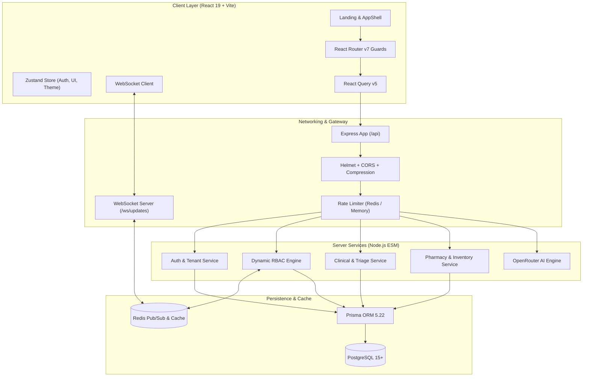

# clinic OS — Complete Architectural & Project Analysis Report

> **Generated on:** 2026-10-10  
> **Repository:** `Clinical-Management-System-official` (`cgs-official-website`)  
> **System Name:** **clinic OS / Zuna Health Clinical Management ERP**  
> **Target Audience:** System Architects, Engineering Leads, Security Officers & Clinical Administrators

---

## Executive Summary

**clinic OS** is an enterprise-grade, multi-tenant **Clinical Management System (CMS) & Healthcare ERP**. Designed for high-scale clinical operations, modern multi-specialty practices, and hospital networks, it provides dynamic role-based access control (RBAC), multi-specialty clinical workflows (Dental, Cardiology, Physiotherapy, and General Medicine), India-compliant pharmacy and inventory tracking (CDSCO Schedules, DPCO ceiling prices, GST/HSN), real-time WebSocket permission synchronization, and OpenRouter-powered AI automation.

The repository is structured as a modern monorepo separating a high-performance **Express/Prisma/PostgreSQL backend** and an aesthetic, reactive **Vite/React 19 frontend** featuring Three.js 3D landing visualizers and Tailwind CSS design tokens.

---

## Repository Structure & Codebase Metrics

```
c:\Users\ELCOT\Desktop\clinic/
├── client/                     # Frontend Application (React 19 + Vite + Tailwind CSS)
│   ├── public/                 # Static assets, branding, and icons
│   ├── src/
│   │   ├── app/                # App entrypoint, global providers, routing guards
│   │   ├── components/         # Atomic UI, layout (AppShell), and shared gates
│   │   ├── features/           # Domain feature slices (Admin, Superadmin, Staff, Cardio, Dental, Physio, Landing, Auth)
│   │   ├── hooks/              # Custom hooks (useAuth, usePermissions, useRolePermissions)
│   │   ├── lib/                # Axios instance, Dev API simulator adapter
│   │   ├── store/              # Zustand state stores (auth, theme, ui, role suggestion)
│   │   └── styles/             # Tailwind & base CSS stylesheets
│   ├── package.json
│   └── vite.config.js
│
├── server/                     # Backend Application (Node.js ES Modules + Express + Prisma)
│   ├── prisma/                 # Prisma ORM schema (599 lines), migration definitions, database seeders
│   ├── scripts/                # Diagnostic scripts, automated E2E verifications, category seeds
│   ├── src/
│   │   ├── config/             # Environment schemas (Zod), Redis pub/sub client, Prisma client
│   │   ├── constants/          # Demo presets, role catalogs, category definitions
│   │   ├── controllers/        # Express HTTP controllers (Auth, Admin, Superadmin, Clinical, AI, Pharmacy)
│   │   ├── middlewares/        # JWT auth, Dynamic RBAC checker, Error handler, Rate limiters, Zod validators
│   │   ├── routes/             # REST route declarations, Swagger docs mount
│   │   ├── services/           # Core domain business logic, AI category generation, RBAC computation
│   │   ├── utils/              # Structured logger, custom errors, OpenAPI specifications
│   │   ├── app.js              # Express application assembly & security middleware
│   │   └── server.js           # HTTP + WebSocket server setup with Redis pub/sub listener
│   ├── Dockerfile              # Production container build
│   ├── Procfile                # Heroku / Railway process manifest
│   ├── railway.json            # Cloud deployment infrastructure configuration
│   └── package.json
│
└── graphify-out/               # Knowledge Graph analysis artifact (946 nodes, 2888 edges, 51 communities)
```

### Knowledge Graph Overview (`graphify`)
- **Total Entities Analyzed:** 182 files · ~213,119 words
- **Graph Topology:** 946 nodes · 2,888 edges · 51 distinct functional communities
- **High-Centrality God Nodes:**
  1. `Button` (109 edges) — Universal UI trigger
  2. `react` (89 edges) — Core component bridge
  3. `Badge` (81 edges) — Status & clinical indicator badge
  4. `lucide-react` (74 edges) — Clinical iconography
  5. `notify` (43 edges) — Toast messaging system
  6. `api` (42 edges) — Central HTTP client with auth & mock interception
  7. `useAuthStore` (41 edges) — Client auth & role state
  8. `Input` (40 edges) — Form inputs
  9. `Modal` (39 edges) — Clinical interaction dialogs
  10. `NotFoundError` (36 edges) — Robust error handling abstraction

---

## System Architecture



---

## Core System Modules & Features

### 1. Multi-Tenancy & Clinic Onboarding Lifecycle
- **Tenant Isolation:** Every clinical record (Patients, Appointments, Prescriptions, Invoices, Inventory, Audit Logs) is strictly partitioned by `tenantId`.
- **Onboarding States:**
  - `PENDING`: Initial clinic registration awaiting platform superadmin review.
  - `ACTIVE`: Approved clinics with provisioned databases, role templates, and default staff credentials.
  - `REJECTED`: Stores explicit rejection reasons displayed to clinic applicants with re-submission options.
  - `SUSPENDED` / `DECOMMISSIONED`: Administrative holds.
- **Dynamic Category Association:** Clinics are assigned a `ClinicCategory` (e.g., Cardiology, Dental, Physiotherapy, General Practice) which automatically sets up specialty modules, default departments, and role templates.

### 2. Dynamic, Zero-Hardcoding RBAC Engine
The platform solves enterprise healthcare permission management through a data-driven model:
- **Permission Matrix:** Formed by combinatorics of `Module` (e.g., `patients`, `appointments`, `prescriptions`, `billing`, `inventory`, `staff`, `roles`) and `PermissionAction` (`view`, `create`, `edit`, `delete`, `export`, `approve`).
- **Granular & Wildcard Support:** Supports exact keys (e.g., `patients.view`) and wildcard administration (`patients.*`, `*`).
- **Role Templates:** Pattern-matching keyword automation (e.g., assigning a role with keyword "nurse" automatically attaches required clinical actions).
- **Redis Multi-Layer Caching:**
  - Effective permissions are computed and cached in Redis with a 5-minute TTL.
  - Role modifications publish a message to `permissions:invalidate`.
  - The WebSocket server broadcasts cache invalidation payloads to affected clients, updating UI permissions immediately without requiring user re-login.

### 3. Specialized Multi-Specialty Clinical Verticals

| Specialty | Core Modules & Features | Key Capabilities |
| :--- | :--- | :--- |
| **General Practice** | Patients, Appointments, Vitals, Consultations, Invoices | MRN tracking, chronological medical records, allergies, ICD-10 notes |
| **Dental Care** | `DentalChartPage`, `TreatmentPlansPage`, `OrthodonticsPage`, `ImplantRegistryPage`, `XrayRecordsPage`, `LabOrdersPage` | Interactive FDI two-arch dental chart (adult/pediatric tooth maps), shade matching, implant serials, dental labs |
| **Cardiology** | `EcgRecordsPage`, `EchoReportsPage`, `CathLabSchedulingPage`, `CardiacRiskAssessmentPage` | ECG lead review, ejection fraction reporting, catheterization lab scheduling, ASCVD/Framingham risk scoring |
| **Physiotherapy** | `TreatmentSessionPlansPage`, `ExerciseProgramTrackerPage`, `ProgressRecoveryNotesPage` | Joint ROM (range-of-motion), pain scale tracking (VAS 1-10), exercise home-care compliance |

### 4. Patient Flow & Clinical Triage Kanban
- **End-to-End Patient Flow (`/app/staff/flow`):**
  1. **Reception / Check-in:** Front-desk intake, identity confirmation, appointment validation.
  2. **Triage / Nurse Station:** Vitals entry (BP, Pulse, SpO2, Temperature, BMI), chief complaint recording.
  3. **Doctor Consultation:** Clinical examination, diagnosis formulation, digital prescriptions, lab test orders.
  4. **Pharmacy Fulfillment:** Direct prescription queue dispensing, drug schedule checks, stock depletion.
  5. **Billing & Discharge:** Automated itemized invoicing, insurance co-pay calculation, payment collection.

### 5. India-Compliant Pharmacy & Inventory Management
- **Schedule Classifications:** Tracks OTC, Schedule H, Schedule H1, Schedule X, and Schedule G drugs with mandatory prescription flags.
- **Regulatory Pricing:** Direct enforcement of **DPCO (Drugs Prices Control Order)** ceiling prices to prevent overcharging.
- **Fiscal Compliance:** HSN codes and statutory GST rate calculations (5%, 12%, 18%).
- **Batch & Expiry Surveillance:** Multi-batch tracking, supplier audit trail, automated warnings for items expiring within 30/60/90 days.
- **Bulk Operations:** Excel (.xlsx) bulk upload and automated field sanitization with validation feedback.

### 6. AI Subsystem (OpenRouter Integration)
- **Category Customization Engine (`ai.service.js`):**
  - Uses modern LLMs (e.g., Gemini 2.5 Flash / Claude) via OpenRouter.
  - Given a new clinical specialty name, automatically generates:
    - Custom patient profile fields & vitals requirements
    - Clinical workflows, procedure catalog, and consumables
    - Role definitions and permission templates
    - Pharmacy category taxonomies & billing charge groups
- **Contextual Clinical Chatbot (`Chatbot.jsx`):**
  - Embedded floating clinical assistant with markdown formatting, streaming, and quick action prompts.

---

## Technical Stack Matrix

### Frontend Stack (`client/`)
| Component | Technology | Version | Purpose |
| :--- | :--- | :--- | :--- |
| **Framework** | React | `^19.2.8` | Component model & UI rendering |
| **Build Tool** | Vite | `^8.2.2` | High-speed bundling & HMR |
| **Styling** | Tailwind CSS & PostCSS | `^3.4.19` | Design tokens, responsive grid |
| **3D Engine** | Three.js & React Three Fiber | `^0.186.0` / `^9.7.0` | Interactive DNA helix visualizer on landing |
| **State Management** | Zustand & React Query | `^5.0.15` / `^5.102.8` | Client & server state caching |
| **Routing** | React Router DOM | `^7.18.3` | Nested routing with role guards |
| **Form Handling** | React Hook Form + Zod | `^7.87.0` / `^3.25.76` | Type-safe form validation |
| **Icons** | Lucide React | `^1.43.0` | Consistent iconography |
| **Linter** | Oxlint | `^1.79.0` | Ultra-fast JS/JSX static analysis |

### Backend Stack (`server/`)
| Component | Technology | Version | Purpose |
| :--- | :--- | :--- | :--- |
| **Runtime** | Node.js (ES Modules) | `>=18.0.0` | Asynchronous JavaScript runtime |
| **Web Server** | Express | `^4.21.2` | REST API routing & middleware |
| **Database ORM** | Prisma Client | `^5.22.0` | Type-safe PostgreSQL mapping |
| **Caching & Pub/Sub** | ioredis | `^5.4.2` | Fast memory store with pub/sub |
| **Realtime** | ws (WebSocket) | `^8.18.0` | Live permission update broadcasting |
| **Authentication** | jsonwebtoken & bcryptjs | `^9.0.2` / `^2.4.3` | JWT access/refresh & password hashing |
| **Validation** | Zod | `^3.24.1` | Runtime schema validation |
| **Documentation** | swagger-ui-express | `^5.0.1` | Interactive OpenAPI documentation |
| **Spreadsheets** | xlsx | `^0.18.5` | Pharmacy bulk import/export |

---

## Database Architecture (Prisma Schema Highlights)

The database schema (`server/prisma/schema.prisma`) comprises **18 relational models** mapped across 7 business domains:

```
[Tenant] ──< 1:N >── [User] ──────────< 1:N >── [UserRole] ──> [Role]
   │                    │                                         │
   ├──< 1:N >── [Patient] ──< 1:N >── [Appointment]               │
   │               │                        │                     │
   │               ├──< 1:N >── [Prescription]                    │
   │               └──< 1:N >── [Invoice] ──< 1:N >── [InvoiceItem]
   │
   ├──< 1:N >── [InventoryItem] ──< 1:N >── [StockMovement]
   ├──< 1:N >── [Department] ────< 1:N >── [StaffProfile]
   ├──< 1:N >── [AuditLog]
   └──< 1:N >── [RoleTemplate]
```

### Critical Database Entities
1. **Tenancy:** `Tenant`, `TenantStatus`, `TenantModule`
2. **Identity & Auth:** `User`, `UserStatus`, `UserType`, `RefreshToken`, `StaffProfile`
3. **Dynamic RBAC:** `Module`, `PermissionAction`, `Permission`, `Role`, `RolePermission`, `UserRole`, `RoleTemplate`
4. **Clinical Core:** `Department`, `Patient`, `Appointment`, `Prescription`, `Invoice`, `InvoiceItem`
5. **Pharmacy/Inventory:** `InventoryItem`, `StockMovement`
6. **Category Engine:** `ClinicCategory`, `ClinicCategoryRoleTemplate`, `ClinicCategoryModule`
7. **Platform & Operations:** `PublicSiteContent`, `NewsletterSubscription`, `DemoRequest`, `Notification`, `AuditLog`

---

## Security, Performance & Reliability

1. **Authentication & Token Lifecycle:**
   - Stateless 15-minute JWT Access Tokens paired with rotating 30-day cryptographically hashed Refresh Tokens.
   - Dual-mode client credentials: works seamlessly with database users and built-in demo profiles (`DEMO_ACCOUNTS`).
2. **Multi-Tenant Protection:**
   - Prisma queries strictly inject `tenantId` constraints in all CRUD operations in `admin.service.js`, `clinical.service.js`, and `pharmacy.service.js`.
3. **Audit Trail & Governance:**
   - Dedicated `AuditLog` model recording every privileged mutation (`CREATE_ROLE`, `UPDATE_PERMISSIONS`, `ASSIGN_STAFF`, etc.) with `beforeState` and `afterState` JSON snapshots.
4. **Resilience & Fallbacks:**
   - In-memory fallback stores for Redis (`MemoryRedisStore`) allow the entire application to run effortlessly in local development environments even if Redis is unavailable.
   - Client-side mock adapter (`devApiSimulator.js`) enables isolated frontend testing without requiring backend connectivity.

---

## Deployment & Production Readiness

- **Containerization:** Production Dockerfile in `server/Dockerfile` with multi-stage build, non-root execution, and healthcheck endpoints (`GET /health`).
- **Cloud Infrastructure:** Native `railway.json` and `Procfile` configurations for rapid zero-downtime deployment.
- **Database Seed Scripts:** Complete seeder suite for instant initialization:
  - `seed.js`: Core roles, initial superadmin, default modules.
  - `seedClinicCategories.js`: Seed categories for Dental, Cardiology, Physiotherapy.
  - `seedCardiologyCategory.js` & `seedPhysiotherapyCategory.js`: Deep clinical category schemas.
- **Verification Suites:** 20+ automated verification scripts in `server/scripts/` validating HTTP endpoints, role scoping, category approvals, and real-time status transitions.

---

## Conclusion & Strategic Recommendations

**clinic OS** displays a mature, modern healthcare architecture capable of scaling across diverse specialty clinics. Key strategic enhancements for future iterations include:

1. **DICOM / PACS Integration:** Connecting dental X-rays and cardio echo image storage with a dedicated PACS/DICOM web viewer.
2. **HL7 / FHIR Standards:** Exposing FHIR-compliant REST endpoints (`/fhir/R4/Patient`, `/fhir/R4/Encounter`) for hospital interoperability.
3. **Automated Database Migrations in CI/CD:** Ensuring `prisma migrate deploy` executes in automated staging pipelines prior to production container deployment.
